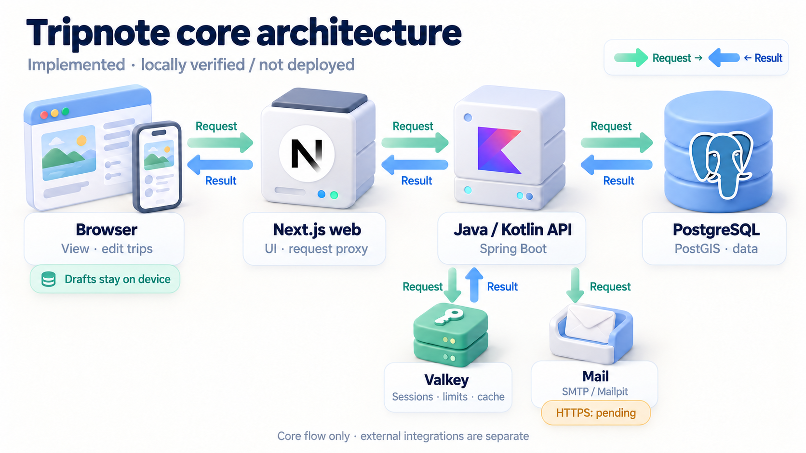
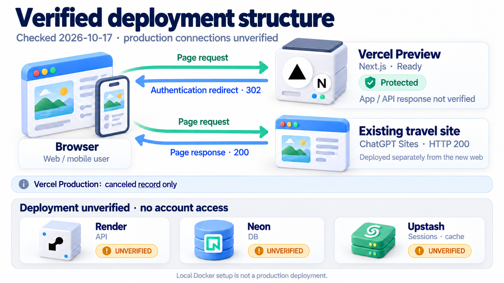

# Tripnote

**Book anywhere. Keep your itinerary here.** A Korean travel itinerary for checking plans and place guides on your phone, then cloning and editing your own trip. The original Osaka–Kyoto family-trip site is preserved while the project grows into a Next.js web app and Kotlin API.

[한국어](README.md) | **English**

[Features](#features) · [Architecture](#architecture) · [Deployment status](#deployment-status) · [Local development](#local-development) · [Verification](#verification) · [Documentation](#documentation)

## Features

| Flow | Implemented behavior |
| --- | --- |
| Start a trip | Destination → dates → travelers creates a private trip. Clone a sample or shared trip into a private copy |
| Read while traveling | Daily itinerary, map and route playback, weather, accommodation, dining, shopping, links and packing guides |
| Edit | Add, auto-save, update, delete, drag or reorder stops; edit notes, links, coordinates and trip/day metadata |
| Interrupted connections | Keep a queue and drafts per user/trip in browser storage; replay serially after reconnecting. Pause on authentication, account or version changes |
| Track visits | Migrate anonymous visit checks once after login and store completion per user on the server. Packing checks stay on the device |
| Read-only sharing | Create/revoke anonymous read links. Store only token hashes in the DB; sharing grants no write access |
| Accounts | Email signup, verification/resend, login, password reset, logout and deletion. Google login entry exists; real provider configuration remains separate |

Cloning does not reuse the original trip, members, share links or completion state. Removing populated days from a trip returns a conflict to preserve data. The public sample list includes Da Nang–Hoi An; the original Osaka–Kyoto trip remains accessible only through its existing link.

### Storage and conflict boundaries

The edit queue and drafts currently use **localStorage**. Blocked or full storage produces a visible save failure; preserve input before closing the tab. Mutation IDs prevent duplicate stop creation after a lost response. Versions prevent overwriting another device’s changes. Conflicts preserve drafts and offer reload, retry and discard actions.

Recovery covers changes in an already-open editor. Offline first visits, a service worker, a single sender lock across tabs and real-time collaborative editing are not implemented.

## Architecture



*The implemented core flow was verified locally. Mint arrows show requests and blue arrows show results; mail shows the send direction only. Drafts stay on the device and HTTPS mail is pending. Map, weather and Google integration details remain in the text. This is not a live production topology.*

The browser uses same-origin `/api/*`, `/oauth2/*` and `/login/oauth2/*` paths through Next.js. The API protects requests with `__Host-SESSION` cookies and CSRF, and validates access, versions and mutation IDs. PostgreSQL stores users, trips, token hashes and durable incomplete mail events. Valkey stores sessions, indexes for user-wide session revocation, rate limits and weather cache. Map tiles are fetched directly by the browser.

Mail transport is separated while preserving event transactions and token issuance. Local development uses SMTP/Mailpit. Production uses a Resend HTTPS adapter that sends a content hash as the Idempotency-Key, so a replay after a lost response does not send identical mail twice. It is covered by mock-server tests only; no real key or sending domain has been verified. The Free profile selects Resend and **fails startup without `RESEND_API_KEY`**. See the [mail integration review](deploy/free/mail.md) in Korean.

| Area | Current technology | Rationale |
| --- | --- | --- |
| Web | Next.js 16.4.2, React 19.3.1, TypeScript 5.9, TanStack Query, generated OpenAPI types | Server rendering, same-origin API paths and contract-based clients |
| UI/maps | CSS Modules, DTCG/Style Dictionary, MapLibre GL JS 6.14 | Shared design tokens, Korean itinerary UI and centralized coordinate conversion |
| API | Java 25, Kotlin 2.3, Spring Boot 4.1.1, Spring Modulith 2.1.1 | One deployment unit with auth/trip/weather boundaries and event handling |
| Data | PostgreSQL 18 + PostGIS, JPA, jOOQ 3.21.9, Flyway 12 | Separate write rules and itinerary-tree queries; version schema changes |
| Auth state | Spring Security, Spring Session indexed repository, Valkey 9.1 | Session revocation on logout/reset, caching and rate limits |
| Verification | Vitest, Testing Library, Playwright/axe, JUnit, Testcontainers, GitHub Actions | Unit coverage through mobile/desktop flows against the real API |

Exact versions come from [web package.json](apps/web/package.json), the [API version catalog](apps/api/gradle/libs.versions.toml) and lockfiles. [ADRs](docs/adr/README.md) contain both implementation rationale and future proposals; distinguish them from current code.

## Deployment status

**Deployment inventory rechecked on 2026-10-17: the existing travel site and a Vercel Preview are confirmed. Production connections for the new service remain unverified.**



*Solid arrows show only HTTP request/response paths observed during this check. The existing site and Preview are separate deployments. Ready does not verify the Preview app or API; unverified services have no connection lines. See the [evidence and limits](docs/verification/2026-10-17-deployment-status.md).*

| Item | State observed in this check |
| --- | --- |
| Existing service | GET to [Osaka–Kyoto Sites](https://osaka-kyoto-family-2026.hyunolike.chatgpt.site/) returned HTTP 200. The legacy Vite site is deployed separately from the new Next.js web |
| New web Preview | The [protected Vercel Preview](https://trip-planner-adkdt83ne-hyunho-jangs-projects.vercel.app) has a Ready deployment record. Page and read-only API requests both returned HTTP 302 with an authentication protection response; current app/API connections could not be verified |
| Vercel Production | **Not deployed: no active Ready Production record for this project.** Of the two records returned, the single Production record is Canceled |
| Render API | **Deployment unverified.** No account tool or local credentials were available to read deployment records or confirm an API endpoint |
| Neon DB / Upstash state store | **Deployment unverified.** Resource existence and connections cannot be inferred without account access |
| Mail / Google | A Resend adapter exists (mock-server tests only). Real keys, sending domain, Google callbacks and live behavior were not verified |

Earlier records of `TRIPNOTE_UI_PREVIEW=1` and the disconnected-API notice are historical evidence, not a fresh runtime verification. Establishing a connected API/DB/cache deployment requires read-only provider records and access to the protected Preview.

[Free deployment preparation](deploy/free/README.md) and `deploy/free/render.yaml` are review configuration, not proof of a current connection. The repository's Free profile selects Resend mail and **cannot start without `RESEND_API_KEY`**. Readiness has a shared three-second budget covering DB and Redis; actual external connections still require verification.

The [512MiB/0.1CPU trial](docs/verification/2026-10-17-free-hosting.md) and [2GB shared-memory trial](docs/verification/2026-10-16-local-memory.md) are local results. Docker configuration and local tests are not production deployments. Live integration, CI/CD and observability validation are tracked in [issue #7](https://github.com/hyunolike/trip-planner/issues/7).

## Local development

Prerequisites: Node.js 22, pnpm 10, **JAVA_HOME pointing to JDK 25**, and running Docker. Start from the repository root. See [web settings](apps/web/.env.example) and the [API README](apps/api/README.md) for variable names; never commit real secrets.

```bash
pnpm install --frozen-lockfile
pnpm --filter @tripnote/design-tokens build
```

API terminal:

```bash
cd apps/api
docker compose up -d --wait
TRIPNOTE_SEED_SAMPLES=true ./gradlew bootRun
```

**Seeding reloads existing samples; use only a development database.** Omit `TRIPNOTE_SEED_SAMPLES` after the first load into an empty development DB. Inspect mail in Mailpit at `http://localhost:8025`. Local Google defaults support redirect-flow checks only.

In another terminal, from the repository root:

```bash
pnpm --filter @tripnote/web dev
```

Web: `http://localhost:3000`; API: `http://localhost:8080`. Use root `pnpm dev` for the legacy Vite site. Root `pnpm build` produces Vite’s `dist/`; the Next.js build command is listed below.

For an API-disconnected preview, set `TRIPNOTE_UI_PREVIEW=1` at **both build time and runtime**. This disables rewrites and returns 503 for API requests/server actions. Connecting an API requires removing the flag in both environments and verifying a new build.

## Verification

From the repository root:

```bash
pnpm test
pnpm sample:validate
pnpm --filter @tripnote/design-tokens test
pnpm --filter @tripnote/web lint
pnpm --filter @tripnote/web typecheck
pnpm --filter @tripnote/web test
pnpm --filter @tripnote/web build
./apps/api/gradlew -p apps/api check
```

API checks also require JDK 25 and Docker. Prepare the real API, development DB/Valkey/Mailpit and seeded samples before Playwright. Tests create and modify test accounts; never point them at production resources.

```bash
pnpm --filter @tripnote/web exec playwright install chromium
pnpm --filter @tripnote/web e2e
```

Playwright uses a production build to check samples, auth, editing, sharing and accessibility at 375px and 1280px. [CI](.github/workflows/ci.yml) runs `samples`, `api`, `web`, and `e2e`; it does not deploy production. After API changes, regenerate `apps/api/openapi.json` through the contract test, then run `pnpm --filter @tripnote/web gen:api`. CI also checks token/jOOQ/OpenAPI generation drift.

## Repository layout

| Path | Purpose |
| --- | --- |
| `apps/web` | Next.js read/edit/auth/share screens and tests |
| `apps/api` | API, Flyway migrations, OpenAPI and integration tests |
| `packages/design-tokens` | Generate CSS and map colors from DTCG sources |
| `sample`, `scripts/sample` | Original/public examples, validation and migration tools |
| `src`, `public`, `tests` | Preserved legacy Vite site |
| `deploy/free`, `scripts/free-tier` | Unapplied free deployment configuration and constrained local trials |
| `docs/adr`, `docs/superpowers`, `docs/verification` | Decisions, design/plans and verification evidence |

## Documentation

- [B2C design](docs/superpowers/specs/2026-10-15-b2c-trip-planner-design.md), [implementation/verification record](docs/superpowers/plans/2026-10-16-codex-mvp-followup.md), [API guide](apps/api/README.md)
- [README evidence and archived SVG record](docs/verification/2026-10-17-readme.md), [3D diagram sources, originals and prompts](docs/architecture/3d-diagrams.md), [reusable README skill](.agents/skills/evidence-readme/SKILL.md)
- [Design system](design-system/README.md), [architecture decisions](docs/adr/README.md)

Image, font and external-material terms follow their source data and credits. This repository does not grant additional redistribution rights to external materials.

Technology marks identify the components and imply no partnership or endorsement. Vercel and Next.js names and logos belong to Vercel, Inc. or its affiliates. Other marks belong to their respective owners. See [official sources](docs/architecture/3d-diagrams.md#공식-로고-출처).
