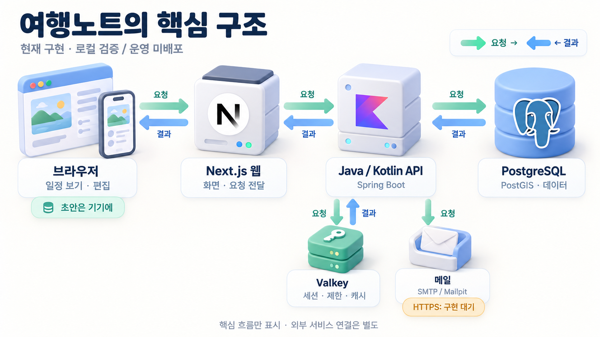
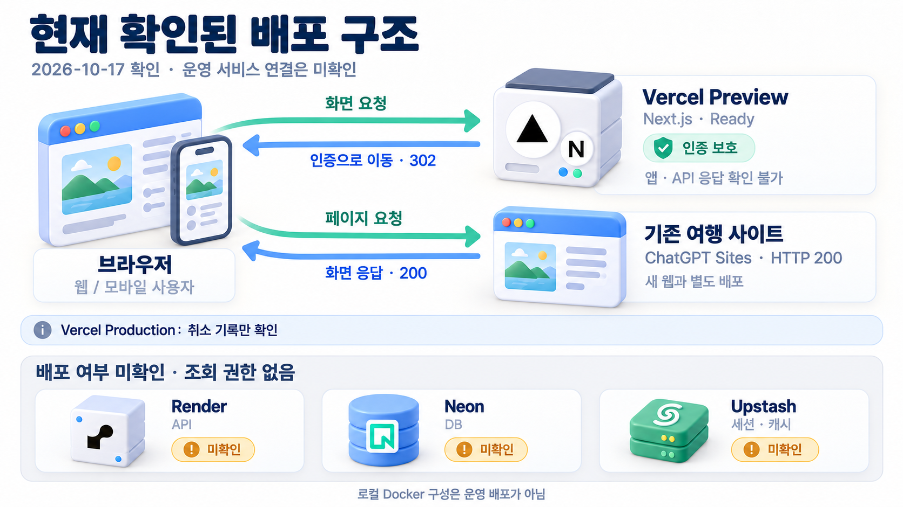

# 여행노트

**예약은 어디서든, 일정은 여기서.** 여행 당일 휴대폰에서 일정과 장소 안내를 확인하고, 내 여행으로 복제해 고칠 수 있는 한국어 여행 일정표입니다. 기존 오사카·교토 가족여행 사이트를 보존하면서 Next.js 웹과 Kotlin API로 확장하고 있습니다.

**한국어** | [English](README.en.md)

[주요 기능](#주요-기능) · [시스템 구조](#시스템-구조) · [배포 상태](#배포-상태) · [로컬 실행](#로컬-실행) · [검증](#검증) · [문서](#문서)

## 주요 기능

| 흐름 | 현재 코드의 동작 |
| --- | --- |
| 내 여행 시작 | 목적지 → 날짜 → 동행의 세 단계로 비공개 여행 생성. 샘플 또는 공유된 여행을 내 비공개 여행으로 복제 |
| 여행 당일 보기 | 날짜별 일정, 지도와 경로 재생, 날씨, 숙소·맛집·쇼핑·링크·준비물 안내 |
| 일정 편집 | 일정 추가·자동 저장·수정·삭제, 순서 이동·드래그, 메모·링크·좌표와 여행·날짜 정보 편집 |
| 연결이 끊긴 동안 | 사용자·여행별 변경 큐와 초안을 브라우저에 보존하고 연결 복구 시 순서대로 전송. 인증 만료·계정 변경·버전 충돌 시 중지 |
| 방문 기록 | 비로그인 방문 체크를 로그인 뒤 한 번 이관하고 회원별 완료 상태를 서버에 저장. 준비물 체크는 기기에 보관 |
| 보기 전용 공유 | 로그인 없이 열 수 있는 링크 생성·회수. 토큰은 DB에 해시만 저장하고 공유로 편집 권한을 주지 않음 |
| 계정 | 이메일 가입·인증·재발송·로그인·비밀번호 재설정·로그아웃·탈퇴. Google 로그인 진입은 구현됐으며 실제 제공자 설정은 별도 |

복제는 원본 여행, 멤버, 공유 링크와 완료 체크를 재사용하지 않습니다. 일정이 있는 날짜를 여행 기간에서 제거하면 충돌을 반환해 데이터를 보존합니다. 공개 샘플 목록에는 다낭·호이안 예시를 제공하며, 오사카·교토 원본은 기존 링크로만 보존합니다.

### 저장과 충돌의 범위

편집 큐와 입력 초안은 현재 **localStorage**를 사용합니다. 저장소가 차단되거나 가득 차면 저장 실패를 표시하므로 탭을 닫기 전에 입력을 보관해야 합니다. 작업 ID는 응답을 잃은 일정 추가의 중복 생성을 막고, 버전 검사는 다른 기기의 변경을 덮어쓰지 않게 합니다. 충돌 시 초안을 유지하며 최신 일정 확인·재시도·변경 버리기를 제공합니다.

이미 열린 편집 화면의 변경 보존과 복구가 대상입니다. 완전한 오프라인 최초 접속, 서비스워커, 탭 사이의 단일 전송 잠금과 동시 공동 편집은 아직 구현하지 않았습니다.

## 시스템 구조



*현재 구현을 로컬에서 검증한 핵심 흐름입니다. 민트는 요청, 파랑은 결과이며 메일은 발송 방향만 표시합니다. 초안은 기기에 보관하고 HTTPS 메일은 구현 대기 상태입니다. 지도·날씨·Google 연동의 세부 경로는 본문을 참고하세요. 운영 배포 구성도는 아닙니다.*

브라우저는 Next.js와 같은 출처의 `/api/*`, `/oauth2/*`, `/login/oauth2/*`를 사용합니다. API는 `__Host-SESSION` 쿠키와 CSRF로 요청을 보호하고 권한·버전·작업 ID를 검증합니다. PostgreSQL은 여행과 사용자 데이터, 토큰 해시와 미완료 메일 이벤트를 저장합니다. Valkey는 세션, 사용자별 세션 취소 인덱스, 요청 제한과 날씨 캐시를 맡습니다. 지도 타일은 브라우저가 직접 조회합니다.

메일 이벤트의 트랜잭션과 토큰 발급은 유지한 채 전송 인터페이스를 분리했습니다. 로컬은 SMTP/Mailpit을 사용합니다. HTTPS 제공자 확장점만 준비됐으며 실제 어댑터는 없습니다. Free profile은 HTTPS를 선택하므로 **승인된 제공자 구현 없이는 시작에 실패합니다**. [메일 연결 검토](deploy/free/mail.md)를 참고하세요.

| 영역 | 현재 기술 | 선택의 맥락 |
| --- | --- | --- |
| 웹 | Next.js 16.4.2, React 19.3.1, TypeScript 5.9, TanStack Query, OpenAPI 생성 타입 | 서버 렌더링과 같은 출처 API 경로, 계약에 맞춘 클라이언트 |
| UI·지도 | CSS Modules, DTCG/Style Dictionary, MapLibre GL JS 6.14 | 공통 토큰과 한국어 일정 화면, 좌표 변환을 한곳에서 관리 |
| API | Java 25, Kotlin 2.3, Spring Boot 4.1.1, Spring Modulith 2.1.1 | 하나의 배포 단위 안에서 auth/trip/weather 경계와 이벤트 처리 |
| 데이터 | PostgreSQL 18 + PostGIS, JPA, jOOQ 3.21.9, Flyway 12 | 쓰기 규칙과 일정 트리 조회를 나누고 스키마 변경을 버전 관리 |
| 인증 상태 | Spring Security, Spring Session indexed repository, Valkey 9.1 | 로그아웃·재설정 시 세션 취소와 캐시·요청 제한 |
| 검증 | Vitest, Testing Library, Playwright/axe, JUnit, Testcontainers, GitHub Actions | 단위 테스트부터 실제 API를 거치는 모바일·데스크톱 흐름까지 검사 |

정확한 버전은 [웹 package.json](apps/web/package.json), [API version catalog](apps/api/gradle/libs.versions.toml), 잠금 파일을 따릅니다. [ADR](docs/adr/README.md)에는 결정의 배경과 후속 제안이 함께 있으므로 현재 구현과 구분해 읽습니다.

## 배포 상태

**2026-10-17에 재확인한 배포 현황입니다. 기존 여행 사이트와 Vercel Preview가 확인됐고, 새 서비스의 운영 연결은 확인되지 않았습니다.**



*실선은 이번 조회에서 확인한 HTTP 요청과 응답만 나타냅니다. 기존 사이트와 Preview는 별도 배포입니다. Preview의 Ready 상태는 앱·API 동작 검증을 뜻하지 않으며, 확인하지 못한 서비스에는 연결선을 그리지 않았습니다. [조회 근거와 제한](docs/verification/2026-10-17-deployment-status.md)을 함께 보세요.*

| 구분 | 이번에 확인한 상태 |
| --- | --- |
| 기존 서비스 | [오사카·교토 Sites](https://osaka-kyoto-family-2026.hyunolike.chatgpt.site/) GET에 HTTP 200. 기존 Vite 사이트이며 새 Next.js 웹과 별도 배포 |
| 새 웹 Preview | [보호된 Vercel Preview](https://trip-planner-adkdt83ne-hyunho-jangs-projects.vercel.app)의 배포 기록은 Ready. 화면과 읽기 전용 API 요청은 모두 HTTP 302로 인증 보호 응답을 반환해 현재 앱·API 연결은 확인 불가 |
| Vercel Production | 해당 프로젝트의 배포 기록 2건 중 Production 1건은 Canceled. 활성 Ready Production 기록 없음 |
| Render API | **배포 여부 미확인**. 계정 조회 도구·로컬 자격증명이 없어 배포 기록과 API 주소를 확인하지 못함 |
| Neon DB / Upstash 상태 저장소 | **배포 여부 미확인**. 계정 접근 없이 생성·연결 상태를 판단하지 않음 |
| 메일·Google | 저장소에는 실제 HTTPS 메일 어댑터가 없음. 실제 자격증명·callback과 운영 동작은 이번에 확인하지 못함 |

이전 기록의 `TRIPNOTE_UI_PREVIEW=1`과 API 미연결 안내를 현재 런타임의 재검증 결과로 사용하지 않았습니다. API·DB·캐시가 연결된 완성 배포 구조를 확정하려면 각 서비스의 읽기 전용 배포 기록과 보호된 Preview 접근이 필요합니다.

[무료 배포 준비](deploy/free/README.md)와 `deploy/free/render.yaml`은 검토용 구성입니다. 현재 연결됐다는 근거가 아닙니다. 저장소의 Free profile은 HTTPS 메일을 선택하며 **승인된 제공자 구현 없이는 시작되지 않습니다**. DB와 Redis를 포함한 readiness는 공통 3초 검사 예산을 쓰지만 실제 외부 서비스 연결은 별도 확인이 필요합니다.

[512MiB·0.1CPU 로컬 시험](docs/verification/2026-10-17-free-hosting.md)과 [2GB 공통 메모리 검증](docs/verification/2026-10-16-local-memory.md)은 로컬 결과입니다. Docker 구성과 로컬 시험을 운영 배포로 표시하지 않습니다. 실제 운영 연결과 CI/CD·관측성 검증은 [후속 이슈 #7](https://github.com/hyunolike/trip-planner/issues/7)에서 추적합니다.

## 로컬 실행

Node.js 22, pnpm 10, **JDK 25를 가리키는 JAVA_HOME**, 실행 중인 Docker가 필요합니다. 아래 명령은 저장소 루트에서 시작합니다. 환경 변수 예시는 [웹 설정](apps/web/.env.example)과 [API README](apps/api/README.md)에 있으며 실제 비밀값은 커밋하지 않습니다.

```bash
pnpm install --frozen-lockfile
pnpm --filter @tripnote/design-tokens build
```

API 터미널:

```bash
cd apps/api
docker compose up -d --wait
TRIPNOTE_SEED_SAMPLES=true ./gradlew bootRun
```

**샘플 시드는 기존 샘플을 다시 적재하므로 개발 DB에서만 사용합니다.** 빈 개발 DB의 첫 적재 뒤에는 `TRIPNOTE_SEED_SAMPLES`를 생략합니다. 메일은 Mailpit의 `http://localhost:8025`에서 확인합니다. Google의 로컬 기본값은 리다이렉트 흐름 검사 용도입니다.

다른 터미널의 저장소 루트에서:

```bash
pnpm --filter @tripnote/web dev
```

웹은 `http://localhost:3000`, API는 `http://localhost:8080`입니다. 기존 Vite 사이트만 실행하려면 루트에서 `pnpm dev`를 사용합니다. 루트의 `pnpm build`는 Vite의 `dist/`를 만들며 새 Next.js 빌드 명령은 아래와 같습니다.

API 없는 화면 미리보기는 **빌드와 런타임 모두** `TRIPNOTE_UI_PREVIEW=1`을 지정합니다. 이 모드에서는 API rewrite를 만들지 않고 요청과 서버 액션에 503을 반환합니다. API를 연결할 때는 두 환경 모두에서 플래그를 제거한 새 빌드를 검증해야 합니다.

## 검증

저장소 루트에서:

```bash
pnpm test
pnpm sample:validate
pnpm --filter @tripnote/design-tokens test
pnpm --filter @tripnote/web lint
pnpm --filter @tripnote/web typecheck
pnpm --filter @tripnote/web test
pnpm --filter @tripnote/web build
./apps/api/gradlew -p apps/api check
```

JDK 25와 Docker가 API 검사에도 필요합니다. Playwright는 실제 API와 개발용 DB·Valkey·Mailpit, 적재된 샘플을 준비한 뒤 실행합니다. 테스트 계정을 생성·변경하므로 운영 자원으로 실행하지 않습니다.

```bash
pnpm --filter @tripnote/web exec playwright install chromium
pnpm --filter @tripnote/web e2e
```

프로덕션 빌드를 사용해 375px와 1280px의 샘플·인증·편집·공유·접근성을 검사합니다. [CI](.github/workflows/ci.yml)는 `samples`, `api`, `web`, `e2e`를 검사하며 운영 배포를 수행하지 않습니다. API 변경 후 계약 테스트로 `apps/api/openapi.json`을 갱신하고 `pnpm --filter @tripnote/web gen:api`로 타입을 생성합니다. 토큰·jOOQ·OpenAPI 생성 결과의 드리프트도 검사합니다.

## 저장소 구조

| 경로 | 역할 |
| --- | --- |
| `apps/web` | Next.js 읽기·편집·인증·공유 화면과 테스트 |
| `apps/api` | API, Flyway 마이그레이션, OpenAPI와 통합 테스트 |
| `packages/design-tokens` | DTCG 원본에서 CSS와 지도 색상 생성 |
| `sample`, `scripts/sample` | 원본·공개 예시와 검증·이관 도구 |
| `src`, `public`, `tests` | 별도로 보존하는 기존 Vite 사이트 |
| `deploy/free`, `scripts/free-tier` | 미적용 무료 배포 설정과 로컬 제약 시험 도구 |
| `docs/adr`, `docs/superpowers`, `docs/verification` | 결정, 설계·계획과 검증 기록 |

## 문서

- [B2C 설계](docs/superpowers/specs/2026-10-15-b2c-trip-planner-design.md), [구현·검증 기록](docs/superpowers/plans/2026-10-16-codex-mvp-followup.md), [API 안내](apps/api/README.md)
- [README 작성 근거와 이전 SVG 기록](docs/verification/2026-10-17-readme.md), [3D 구성도 근거·원본·생성 프롬프트](docs/architecture/3d-diagrams.md), [재사용 README 스킬](.agents/skills/evidence-readme/SKILL.md)
- [디자인 시스템](design-system/README.md), [아키텍처 결정](docs/adr/README.md)

이미지·폰트와 외부 자료의 출처·이용 조건은 각 데이터와 크레딧을 따릅니다. 이 저장소가 외부 자료의 별도 재배포 권리를 부여하지는 않습니다.

구성도의 기술 마크는 해당 기술을 식별하기 위한 표기이며 제휴나 인증을 뜻하지 않습니다. Vercel과 Next.js 이름·로고는 Vercel 및 계열사의 상표이며, 다른 마크도 각 권리자에게 속합니다. [공식 출처](docs/architecture/3d-diagrams.md#공식-로고-출처)를 참고하세요.
